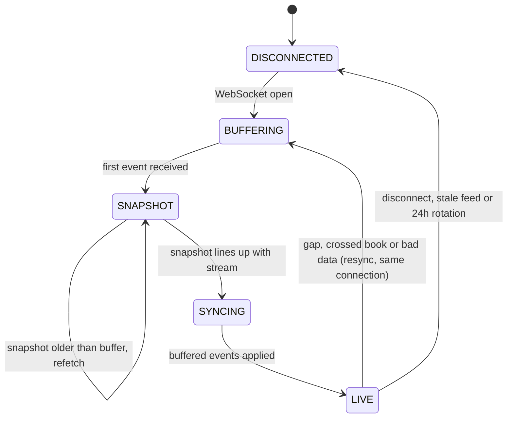

# orderbook-engine

A full-depth **local limit order book** for Binance spot, kept in memory from the live WebSocket feed, and built to keep running correctly through disconnects, missed messages, bad data and rate limits.

Python · asyncio · no AI, no strategy: just a book you can trust.

```
22:01:48 INFO [BTCUSDT] DISCONNECTED -> BUFFERING
22:01:48 INFO [BTCUSDT] BUFFERING -> SNAPSHOT
22:01:49 INFO [BTCUSDT] SNAPSHOT -> SYNCING
22:01:49 INFO [BTCUSDT] SYNCING -> LIVE
22:01:50 INFO [BTCUSDT] id=101589126642 bid 81493.03 x 5.69859 | ask 81493.04 x 0.52022 | spread 0.01 | levels 5000/5000 | events=13
```

## Features

- **Full depth**: up to 5,000 price levels per side, exact `Decimal` prices (no float rounding).
- **Correct sync**: follows Binance's snapshot + diff-stream procedure and checks every update ID. A single missed message is detected and the book is rebuilt.
- **Never crashes**: every failure ends in a resync or a reconnect; the run loop only stops when you stop it.
- **All-or-nothing updates**: each event is fully validated before the book is touched, so it is never left half-updated.
- **Rate-limit aware**: budgets REST request weight per minute, reads Binance's `X-MBX-USED-WEIGHT-1M` header, and obeys `429` / `418` + `Retry-After`.
- **Self-healing connection**: detects silent feeds, reconnects with jittered exponential backoff, and rotates connections before Binance's 24-hour cutoff.
- **Bounded memory**: capped levels per side and a capped event buffer.
- **Multi-symbol**: one task per symbol, sharing a single rate-limit budget.
- **Tested against failures**: a fake Binance server injects faults and checks the local book matches the true book level for level.
- **Live terminal view** (`view.py`) and a **data recorder** (`recorder.py`) that saves the book and every trade for research.

## How it works

Each symbol runs its own state machine:



**Sync procedure** (Binance spot):

1. Open `<symbol>@depth@100ms` and buffer every event.
2. Fetch a REST snapshot (`/api/v3/depth?limit=5000`) and note its `lastUpdateId`.
3. Drop buffered events with `u <= lastUpdateId`.
4. If the first remaining event has `U > lastUpdateId + 1`, the snapshot is too old: fetch again.
5. Apply events in order. For each one:
   - `u <= local id` → already in the book, ignore
   - `U > local id + 1` → a gap: rebuild the book
   - otherwise → apply it (quantity `0` deletes the level) and set `local id = u`

## Quick start

Requires **Python 3.10+**.

```bash
git clone https://github.com/jonathannicolasdev/orderbook-engine.git
cd orderbook-engine
python3 -m venv .venv
source .venv/bin/activate          # Windows: .venv\Scripts\activate
pip install -r requirements.txt
python lob.py BTCUSDT
```

Watch several pairs at once:

```bash
python lob.py BTCUSDT ETHUSDT SOLUSDT
```

Press `Ctrl+C` to stop cleanly.

> **macOS:** if you see `CERTIFICATE_VERIFY_FAILED`, run `Install Certificates.command` from your `/Applications/Python 3.x/` folder.

## Live terminal view

```bash
python view.py BTCUSDT
```

A full-screen price ladder that redraws 10 times a second: asks in red above, bids in green below, with size, running total and a depth bar for each level, plus mid price (with ▲/▼ direction), spread in bps, updates per second and connection health.

```
╭──────────────────────────────────────────────────────────────────────────────╮
│  BTCUSDT   ● LIVE   mid 81493.035 ▲   spread 0.01 (0.00 bps)   48 updates/s  │
│                                                                              │
│        price        size       total                                         │
│    81,493.08     0.41000     1.82022  ██▉                                    │
│    81,493.06     0.89000     1.41022  ██████▏                                │
│    81,493.04     0.52022     0.52022  ███▋                                   │
│ ────────────  ──────────  ──────────  0.01 spread                            │
│    81,493.03       5.699       5.699  ████████████████████████████           │
│    81,493.01       1.200       6.899  █████▉                                 │
│    81,492.95       0.31000     7.209  ██▏                                    │
╰──────────────────────────────────────────────────────────────────────────────╯
```

| Option | Example | What it does |
|---|---|---|
| `--levels N` | `--levels 20` | Rows per side (default: fits the window) |
| `--group G` | `--group 1` | Merge prices into buckets, e.g. whole dollars |
| `--fps F` | `--fps 4` | Screen refreshes per second |
| `--ws-base` / `--rest-base` | see Configuration | Alternative endpoints |

The border turns yellow and rows dim whenever the book is resyncing or the feed is stale, so you never mistake old data for live. Logs go to `lob.log`. Press `Ctrl+C` to quit.

## Recording data

```bash
python recorder.py BTCUSDT ETHUSDT
caffeinate -i python recorder.py BTCUSDT     # macOS: stop the Mac sleeping while it records
```

Saves the top of the book a few times a second and **every trade**, one file per UTC hour per symbol, gzipped when the hour ends:

```
data/
├── recorder.log
└── BTCUSDT/
    ├── events.csv                 # resyncs, reconnects, trade gaps and how they were filled
    └── 2026-10-19/                # UTC date
        ├── book_03.csv.gz         # top 10 levels, every 0.25 s
        └── trades_03.csv.gz       # every aggregated trade
```

| File | Columns |
|---|---|
| `book_*.csv.gz` | `recv_ms, event_ms, update_id, bid_px_1, bid_qty_1 … bid_px_10, bid_qty_10, ask_px_1, ask_qty_1 … ask_px_10, ask_qty_10` |
| `trades_*.csv.gz` | `recv_ms, trade_ms, agg_id, price, qty, aggressor, source` |

- `recv_ms` is your clock; `event_ms` / `trade_ms` are Binance's (milliseconds since 1970, UTC).
- `aggressor` is who crossed the spread: `buy` means a buyer took the ask.
- **No trade holes:** trade IDs are checked, and anything missed (disconnects, dropped messages) is fetched back from REST (`source=rest`). Anything that truly can't be recovered is written to `events.csv` as `trades_lost`, never silently skipped.
- **No bad book rows:** snapshots are only written while the book is synced and fresh; gaps in time are explained in `events.csv`.
- **Crash-safe:** the current hour is written as plain CSV and flushed every second; leftovers are compressed on the next start, and a restart never overwrites an existing file.

Options: `--depth 10` (levels per side), `--interval 0.25` (seconds between snapshots), `--out data` (folder). Expect very roughly 30–60 MB per symbol per day, compressed (more for busy pairs).

Loading it for analysis (with `pip install pandas`):

```python
import glob, pandas as pd
book = pd.concat(pd.read_csv(f) for f in sorted(glob.glob("data/BTCUSDT/*/book_*.csv*")))
trades = pd.concat(pd.read_csv(f) for f in sorted(glob.glob("data/BTCUSDT/*/trades_*.csv*")))
book["time"] = pd.to_datetime(book["recv_ms"], unit="ms", utc=True)
trades["time"] = pd.to_datetime(trades["trade_ms"], unit="ms", utc=True)
```

## Using the book in your own code

```python
import asyncio, aiohttp
from lob import Config, BookSync, RateLimitedRest

def on_update(sync: BookSync) -> None:
    if sync.ready:                        # synced AND data is fresh
        bid, ask = sync.book.best_bid(), sync.book.best_ask()
        print(bid, ask, sync.book.spread())

async def main():
    async with aiohttp.ClientSession() as session:
        rest = RateLimitedRest(session, Config.rest_base)
        sync = BookSync(Config(symbol="BTCUSDT"), rest, on_update=on_update)
        await sync.run()                  # runs until cancelled

asyncio.run(main())
```

Always check `sync.ready` before reading the book or trading on it.

| `OrderBook` method | Returns |
|---|---|
| `best_bid()` / `best_ask()` | `(price, qty)` or `None` |
| `mid()` / `spread()` | `Decimal` or `None` |
| `top(n)` | best `n` levels per side, as lists of `(price, qty)` |
| `depth_within(pct)` | total bid / ask quantity within `pct` of mid |
| `is_crossed()` | `True` if best bid ≥ best ask (never in a healthy book) |

## Configuration

Set on `Config(...)`:

| Option | Default | What it does |
|---|---|---|
| `symbol` | `BTCUSDT` | Trading pair |
| `ws_base` / `rest_base` | Binance spot | Endpoints (swap for `data-stream.binance.vision` / `data-api.binance.vision` if needed) |
| `stream_speed` | `100ms` | `100ms` or `""` for 1000ms updates |
| `snapshot_limit` | `5000` | Levels per side in the REST snapshot |
| `max_levels` | `5000` | Levels kept per side (bounds memory) |
| `stale_after` | `10.0` | Seconds without data before reconnecting |
| `max_buffer` | `50000` | Queued events before the consumer is considered too slow |
| `rotate_after` | `82800` | Seconds before a planned reconnect (Binance cuts at 24h) |
| `min_snapshot_interval` | `1.0` | Minimum seconds between snapshot requests |
| `max_resyncs_per_connection` | `5` | Resyncs on one connection before reconnecting |
| `backoff_base` / `backoff_max` | `1.0` / `60.0` | Reconnect backoff range, in seconds |

## Testing

```bash
pytest -q
```

The tests start a fake Binance (REST + WebSocket) on localhost that keeps a "true" book and streams real-format diff events. Each test injects a failure, then checks the local book is **identical, level for level**, to the true book:

| Failure injected | Expected behaviour |
|---|---|
| Missed message (sequence gap) | Resync on the same connection |
| Dropped connection | Reconnect and resync |
| Unparseable frame | Skipped; resulting gap caught |
| Nonsense prices | Rejected before touching the book; resync |
| `429` on snapshot | Waits for `Retry-After`, then recovers |
| Silent feed | Marked not ready, reconnects |
| Snapshot older than buffer | Refetched |
| Exchange down at startup | Retries until it's up |
| 24h rotation | Clean reconnect, not counted as a failure |
| Exception in your callback | Logged; book unaffected |

A 45-second soak test with random faults every 0.1–0.6 s (about 9,800 events, 18 resyncs, 10 reconnects) matched the true book on all 31 checks, with memory flat at about 3.5 MB.

## Known limitations

- **Depth edge:** a Binance snapshot holds at most 5,000 levels per side. Levels further out that never change never appear in the diff stream, so they cannot be known locally. That's why the level count can dip below 5,000.
- **Spot only:** USD-M futures and other exchanges (e.g. dYdX) use different sequencing rules; only the sync logic needs changing.
- **Market data only:** this keeps a book. It does not place orders.

## Roadmap

- [x] Record book snapshots and every trade to disk
- [ ] Signals from recorded data: imbalance, microprice, trade flow
- [ ] Test whether signals predict short-term moves, net of fees
- [ ] Replay simulator with realistic fills (fees, latency, queue position)
- [ ] Order execution over the user-data stream (spot testnet first)
- [ ] Order-count rate limits and reconciliation after reconnect
- [ ] Futures (`pu` sequencing) support
- [ ] Optional Rust core for lower latency

## Project structure

```
orderbook-engine/
├── lob.py             # order book, rate limiter, state machine, demo runner
├── view.py            # live full-screen terminal view
├── recorder.py        # records book snapshots + every trade to disk
├── test_lob.py        # fake exchange + failure tests
├── test_view.py       # terminal view tests
├── test_recorder.py   # recorder tests (gaps, backfill, rotation, crash recovery)
├── requirements.txt
├── LICENSE
└── README.md
```

## Disclaimer

For educational and research purposes. Not financial advice. Check that crypto trading and the exchange you use are permitted where you live before trading real money.

## License

[MIT](LICENSE)
